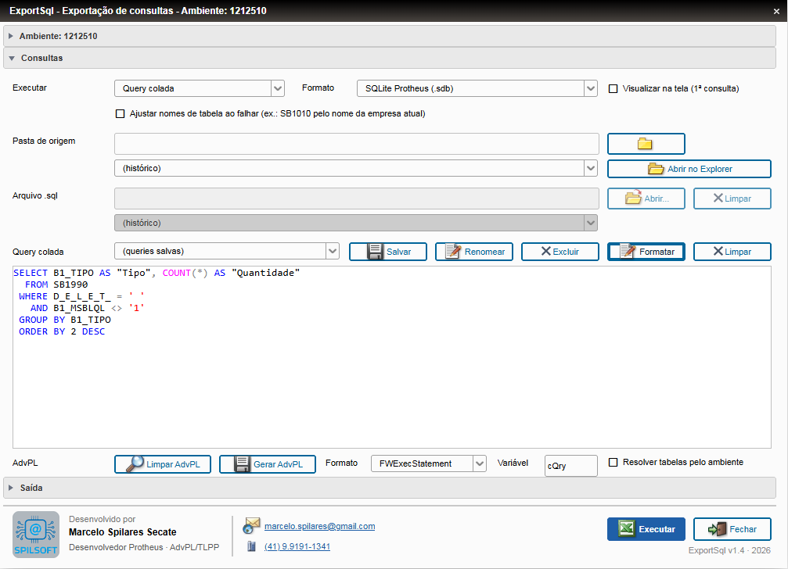

# ExportSql

Consultas SQL dentro do TOTVS Protheus, com exportação para **Excel (.xlsx)** ou **.sdb do Protheus** (SQLite, o mesmo formato do APSDU) e visualização na tela.

**Site:** https://marcelosecate.github.io/ExportSql/

## Download

- Patch: [download/exportsql_v1_5_1.ptm](https://github.com/marcelosecate/ExportSql/raw/main/download/exportsql_v1_5_1.ptm)
- Instalação e uso: [LEIA-ME.txt](LEIA-ME.txt)

Testado no Protheus 12.1.2510 (AppServer 7.00.240223P) com SQL Server, pelo SmartClient webapp.

## Recursos

- Uma ou várias consultas (arquivo .sql ou query colada), um arquivo por consulta.
- Excel: .xlsx com a query documentada numa aba.
- .sdb: o arquivo local do Protheus (o mesmo do APSDU), com tipos e tamanhos de cada campo, para filtrar registros por SQL numa base e importar em outra; um .txt ao lado guarda a query executada.
- Visualização do resultado na tela, em grade, até 10.000 linhas.
- Queries salvas com nome (salvar, renomear e excluir), para usar de novo.
- Editor com cores no estilo do SQL Server Management Studio e botão Formatar.
- Conversão de query para código AdvPL (String, BeginSql ou FWExecStatement) e o caminho inverso.
- Somente consultas: comandos de alteração são bloqueados.
- Datas e números tipados pelo dicionário (SX3) e ajuste automático de nomes de tabela entre empresas.
- Acesso com usuário e senha do Protheus, restrito ao grupo Administradores, com auditoria de cada execução.
- Usuário, empresa, filial e opções da tela lembrados para cada servidor e ambiente (a senha nunca é gravada).

## Como usar

1. Faça backup do RPO e aplique o patch `exportsql_v1_5_1.ptm`.
2. No SmartClient ou no webapp, informe o programa inicial `U_SPILR01`.
3. Entre com empresa, filial e um usuário do grupo Administradores.

Detalhes, segurança e limitações conhecidas no [LEIA-ME.txt](LEIA-ME.txt).

## Novidades da v1.5.1

- Correção: campos numéricos que não estão no dicionário (SX3), como X3_TAMANHO e X3_DECIMAL das próprias tabelas do dicionário, saem com o tamanho e as casas decimais da tabela de origem (antes vinham com 8 casas decimais no .sdb).

## Novidades da v1.5

- Tela em duas seções (Ambiente e Consultas): a pasta de destino e o botão Auditoria passaram para Consultas, no lugar da pasta de origem (o arquivo .sql já guarda o caminho completo).

## Novidades da v1.4

- Opções da tela (formato, o que executar, visualizar, ajuste de tabelas, linha AdvPL e seção aberta) lembradas para cada servidor e ambiente.
- Resumo da execução com a opção "Abrir a pasta de destino ao fechar", que fica gravada.

## Novidades da v1.2

- Queries salvas com nome na linha da query colada.
- Tela em três seções (Ambiente, Consultas e Saída), com botão Conectar; as opções da execução (o que executar, formato, visualizar e ajuste de tabelas) ficam em Consultas.
- Usuário, empresa e filial lembrados para cada servidor e ambiente.
- Botão Copiar no resumo da execução.
- Formatar: colunas simples na linha do SELECT, ON na linha do JOIN e subqueries (EXISTS/NOT EXISTS) formatadas.
- Grade de resultado com números alinhados à direita e demais tipos à esquerda.
- Barras de rolagem na query colada e correção no combo de queries salvas.

## Licença

Gratuito, sob a [licença MIT](LICENSE): fornecido como está, sem garantia.

Protheus e TOTVS são marcas da TOTVS S.A. Este projeto não é afiliado à TOTVS.

## Autor

Marcelo Spilares Secate · SpilSoft
marcelo.spilares@gmail.com · WhatsApp (41) 9.9191-1341
